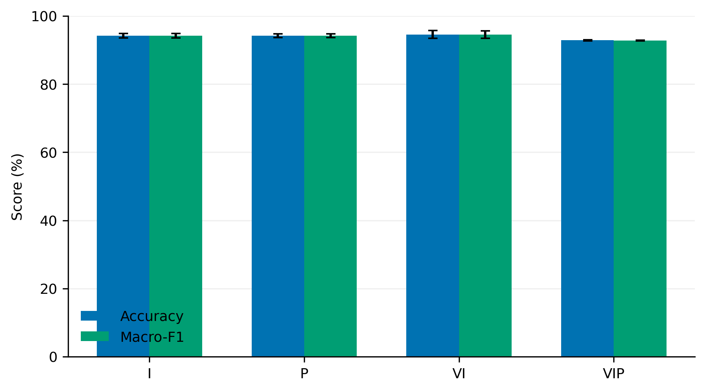
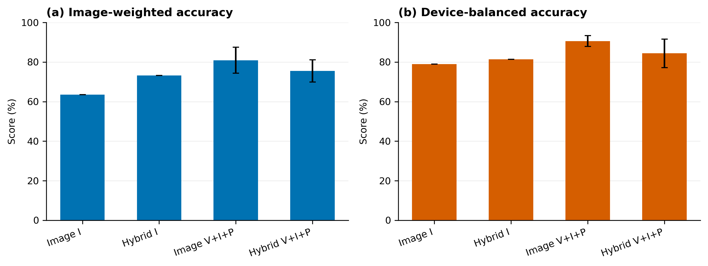
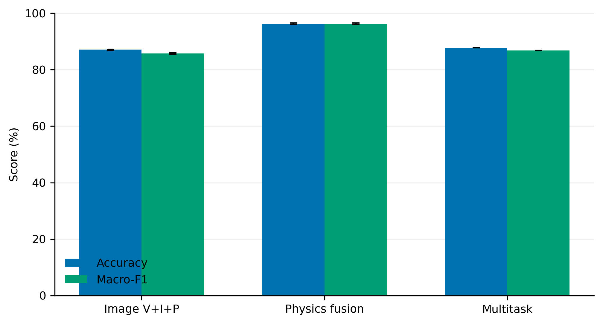
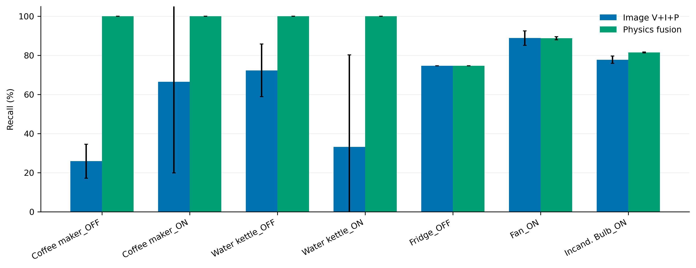

# Leakage-Aware Multi-Physical GASF Imaging for Plug-Load Appliance and State Recognition

**Draft status:** working scientific draft; author identifiers and repository URLs remain to be completed.

**Target journal:** *Electronics* (MDPI), research article.

**Authors:** Xianli Zeng^1,\*, Qinghua Zhou^1

**Affiliation:** ^1 Changsha University of Science and Technology, Changsha, China

**Corresponding author:** Xianli Zeng, zengxianli0626@163.com

**ORCID:** [[ORCID for Xianli Zeng and Qinghua Zhou]]

## Abstract

High-frequency voltage and current measurements contain informative load signatures, but image-based recognition can report misleading accuracy when class labels leak into pixels or correlated cycles cross evaluation splits. This study develops a leakage-aware multi-physical Gramian angular summation field (GASF) pipeline for event-aligned plug-load recognition. Voltage-aligned voltage, current, and power cycles are converted into three-channel images and classified with a compact convolutional neural network. Two independent PLAID tasks are studied: 11-class appliance-type recognition and 26-state appliance type with ON/OFF recognition. Images contain no rendered labels, and primary splits are separated by source recording; the appliance task is also evaluated with device-disjoint splits. For 11-class recognition, the selected three-channel model reaches 92.86 ± 0.13% test accuracy under unseen-recording evaluation and 80.90 ± 6.61% image-level accuracy under unseen-device evaluation. For 26-state recognition, adding 14 physical amplitude, power, power-factor, and harmonic features increases mean test accuracy from 87.06 ± 0.13% to 96.23 ± 0.23% and macro-F1 from 85.72 ± 0.17% to 96.23 ± 0.24% across three seeds. Physical features resolve the severe Coffee maker/Water kettle confusion and provide a compact, reproducible baseline for electronic load monitoring.

**Keywords:** non-intrusive load monitoring; appliance recognition; Gramian angular summation field; physical feature fusion; compact CNN; PLAID

## 1. Introduction

Appliance-level electrical information supports energy management, demand response, occupancy-aware services, and fault detection. Installing a sensor on every appliance is expensive, so non-intrusive load monitoring (NILM) infers load activity from a limited number of measurement points [1]. High-frequency voltage and current waveforms contain switching transients, harmonic structure, and nonlinear load behavior that are unavailable in low-rate active-power measurements [2]. These signatures are particularly useful for distinguishing appliance categories and operating states.

Deep learning has made high-frequency plug-load recognition increasingly practical. However, an apparently high classification accuracy may result from evaluation leakage. Generated images can contain class names drawn into the pixels, allowing a network to learn text instead of electrical behavior. Adjacent cycles from one recording can also enter both training and test sets after random image splitting. Such results do not measure recognition of unseen recordings or devices.

This study develops a leakage-aware pipeline with two independent recognition tasks. In the first, 11 appliance types are classified from individual high-frequency recordings. In the second, 13 appliance types are combined with ON/OFF states to form 26 labels; a zero-load baseline is used to isolate event-related differential current and power. Each physical sequence is converted into a GASF image, and the three fields are stacked into an RGB-like tensor. A compact four-stage CNN provides a low-parameter image baseline. Because GASF normalization removes absolute amplitude information, the 26-state model is extended with a small physical-feature branch containing RMS amplitude, power, power factor, crest factor, total harmonic distortion, and low-order harmonic ratios.

The contributions are:

1. A corrected multi-physical GASF representation with no rendered text or metadata in the model input.
2. Recording-grouped evaluation and device-disjoint validation that separate recording, device, and label leakage.
3. A controlled channel analysis for appliance-type recognition, showing that apparent recording-level gains do not necessarily transfer to unseen devices.
4. A compact image-plus-physics model that substantially improves joint type/state recognition and stabilizes difficult heating-load classes.

The scope is event-aligned plug-load recognition. The study does not claim disaggregation of arbitrary aggregate building mains.

## 2. Related Work

NILM methods are commonly divided into event-based and non-event-based approaches [1]. Event-based methods detect switching transitions and classify the associated load signature, while non-event-based methods estimate consumption from aggregate power. High-frequency voltage-current trajectories and transient descriptors provide stronger separation than average power alone when loads have similar energy use but different electrical behavior [3].

Gramian angular fields map a one-dimensional sequence into a two-dimensional representation through pairwise angular relations [4]. GASF uses `sin(phi_i + phi_j)`, whereas the difference version, GADF, uses `sin(phi_i - phi_j)`. The present implementation explicitly uses GASF. Image-based time-series classification has been applied to load identification [5], but its benefit depends strongly on preprocessing, input resolution, and split design.

Resource-aware recognition favors compact networks with deterministic preprocessing. A four-stage CNN with batch normalization, dropout, and global average pooling provides a useful low-capacity baseline. Grouped validation is required when samples are correlated within recordings [6]. A stronger device-disjoint split also prevents the same physical appliance from appearing in training and test data.

## 3. Data and Problem Definition

### 3.1 PLAID data

The experiments use PLAID, a high-frequency plug-load dataset containing voltage and current measurements of household appliances [7]. The sampling frequency is 30 kHz.

| Task | Labels | Images | Train | Validation | Test |
|---|---:|---:|---:|---:|---:|
| 11-class appliance type | 11 | 55,000 | 43,592 | 5,686 | 5,722 |
| 26-state type/state | 26 | 130,000 | 102,312 | 13,883 | 13,805 |

The 11-class experiment uses individual appliance recordings. The 26-state experiment uses event-aligned recordings with a corresponding zero-load reference and covers 13 appliance categories with ON and OFF states.

### 3.2 Recording-grouped split

All cycles derived from the same source recording are assigned to one split. This prevents correlated adjacent cycles from appearing in both training and test data. The 11-class dataset contains 1,772 source groups, and the 26-state dataset contains 2,710 selected source groups. No group occurs in more than one split.

### 3.3 Device-disjoint evaluation

For the 11-class task, PLAID metadata are used to derive 1,095 device identifiers. A separate leave-device-out protocol ensures that no device appears in both training and test data. Three device split seeds are used. This protocol evaluates transfer to unseen physical equipment rather than only to unseen recordings.

## 4. Method

### 4.1 Event-aligned cycle extraction

For the 11-class task, the first CSV column is current and the second is voltage. Upward voltage zero crossings define the start of each cycle. A complete cycle contains 500 samples, corresponding to one 60 Hz period at 30 kHz:

`N = f_s / f_0 = 30,000 / 60 = 500`.

Instantaneous power is:

`p[n] = v[n] i[n]`.

For the 26-state task, a zero-load recording provides a phase-aligned baseline. The model inputs are:

`Delta i[n] = i_load[n] - i_zero[n]`,

`Delta p[n] = p_load[n] - p_zero[n]`,

with the zero-load voltage used as the phase reference. The difference emphasizes the event and suppresses background load.

### 4.2 GASF image construction

Each physical sequence is mapped to `[-1, 1]`:

`x_norm = 2 (x - min(x)) / (max(x) - min(x)) - 1`.

The angular representation is:

`phi = arccos(x_norm)`.

The GASF matrix is:

`G_ij = sin(phi_i + phi_j)`.

The three matrices are normalized to `[0, 1]` and stacked:

`R = GASF(v)`, `G = GASF(i)`, `B = GASF(p)`.

For the 26-state task, current and power denote the baseline-corrected values. The `500 x 500 x 3` tensor is resized to `64 x 64`. Images are saved directly as numerical RGB arrays. No title, axes, class name, colorbar, or extra whitespace is rendered into the training image.

### 4.3 Compact CNN

The image model has four convolutional stages with 16, 32, 64, and 128 channels. Each stage uses a `3 x 3` convolution, batch normalization, ReLU, max pooling, and dropout. Global average pooling is followed by a two-layer classifier. The model has 106,891 parameters for the 11-class task and 107,866 parameters for the 26-state task.

Training uses AdamW, learning rate `5e-4`, weight decay `1e-4`, label smoothing `0.05`, and validation-based early stopping. The best validation checkpoint is evaluated once on the test set.

### 4.4 Physical-feature fusion

Per-cycle GASF normalization retains waveform shape but removes absolute amplitude. The 26-state model therefore uses 14 additional physical features:

- RMS voltage and current;
- active and apparent power;
- power factor;
- current peak and crest factor;
- current total harmonic distortion;
- third-, fifth-, and seventh-harmonic ratios;
- mean absolute current and power;
- logarithm of absolute active power.

The image encoder outputs 128 features and the physical branch outputs 32 features. The concatenated vector is classified by a compact multilayer network. The fusion model contains 117,498 parameters. Feature standardization is fitted using training data only.

### 4.5 Leakage controls

The reported experiments use the following controls:

1. Images contain only numerical pixels.
2. Primary splits are separated by source recording.
3. The 11-class device study separates physical devices across training and test sets.
4. Image-level random splitting is not used for reported performance.
5. The test set is not used for hyperparameter or checkpoint selection.
6. Physical-feature normalization statistics are computed only from training data.

## 5. Results

### 5.1 Leakage audit

Historical image files from the development pipeline contained rendered class and state text. Resizing the full image to `64 x 64` retained a class-specific top band. A top-row diagnostic reached 99.83% accuracy for 26 labels when the title-bearing image was used, demonstrating that the text can act as a direct label shortcut.

After correction, generated images contain only numerical GASF pixels. The corrected recording-grouped split has zero source-group overlap. The 11-class device-disjoint split has zero device overlap across train, validation, and test sets.

### 5.2 Eleven-class recording-level performance

Table 1 reports the channel comparison over three seeds.

| Input | Test accuracy | Test macro-F1 |
|---|---:|---:|
| Current only (I) | 94.23 ± 0.66% | 94.20 ± 0.67% |
| Power only (P) | 94.20 ± 0.53% | 94.17 ± 0.54% |
| Current + voltage (V+I) | 94.57 ± 1.14% | 94.54 ± 1.14% |
| Three-channel (V+I+P) | 92.86 ± 0.13% | 92.82 ± 0.09% |

The single-current model has the highest recording-level accuracy and the simplest input. V+I has the highest mean test score but approximately twice the variance of V+I+P. Figure 1 visualizes the channel comparison.

### 5.3 Eleven-class device-level performance

The selected model for unseen-device transfer is the three-channel image CNN. Table 2 compares it with the physical-fusion alternatives.

| Model | Image accuracy | Image macro-F1 | Device mean | Class-balanced device |
|---|---:|---:|---:|---:|
| Image I | 63.51% | 65.08% | 78.94% | 77.69% |
| Image V+I+P | **80.90 ± 6.61%** | **81.78 ± 6.81%** | **90.62 ± 2.76%** | **88.20 ± 2.46%** |
| Hybrid I | 73.20% | 74.89% | 81.37% | 82.19% |
| Hybrid V+I+P | 75.54 ± 5.61% | 77.12 ± 5.18% | 84.42 ± 7.22% | 81.51 ± 9.30% |

The image-only three-channel model provides the strongest device-level result. Physical features improve selected categories such as Fridge and Fan but reduce stability and overall device-balanced performance. Figure 2 shows image-weighted and device-balanced comparisons.

### 5.4 Twenty-six-state results

Table 3 compares the 26-state models.

| Model | Test accuracy | Test macro-F1 | Parameters |
|---|---:|---:|---:|
| Image V+I+P, three seeds | 87.06 ± 0.13% | 85.72 ± 0.17% | 107,866 |
| Multitask type/state, seed 42 | 87.74% | 86.84% | 111,215 |
| Image + physical features, three seeds | **96.23 ± 0.23%** | **96.23 ± 0.24%** | 117,498 |

Figure 3 summarizes the accuracy and macro-F1 comparison. Physical fusion improves image-only mean performance by 9.18 accuracy points and 10.51 macro-F1 points. The multitask architecture improves only 0.68 and 1.12 points, respectively.

### 5.5 Class-specific effects

Table 4 reports selected recalls for the 26-state image and fusion models.

| Class | Image V+I+P | Physical fusion |
|---|---:|---:|
| Coffee maker_OFF | 25.89% | **100%** |
| Coffee maker_ON | 66.54% | **100%** |
| Water kettle_OFF | 72.32% | **100%** |
| Water kettle_ON | 33.22% | **100%** |
| Fridge_OFF | 74.63% | 74.63% |
| Fan_ON | 88.85% | 88.79% |
| Incandescent Light Bulb_ON | 77.78% | 81.52% |
| Compact Fluorescent Lamp_OFF | 99.02% | 94.34% |

The image-only model changes the Coffee maker/Water kettle assignment across seeds. Fusion produces 100% recall for all four classes in every seed. Figure 4 shows these differences.

Fridge_OFF remains unchanged at 74.63% across seeds, indicating a persistent class-definition or operating-condition challenge. Incandescent Light Bulb_ON also remains below 82%.

### 5.6 Training stability

The physical-fusion model reaches best validation accuracies of 98.04%, 98.11%, and 98.02% for seeds 42, 43, and 44. Test accuracy is 96.28%, 95.99%, and 96.43%, respectively. The small standard deviations demonstrate that the improvement is not caused by one favorable initialization.

## 6. Discussion

The central result is the difference between leakage-free recording-level performance and device-level transfer. Removing rendered labels and separating correlated recordings prevents the network from exploiting shortcuts unavailable in deployment. A high image-level accuracy can therefore be interpreted as recognition of waveform signatures rather than recognition of embedded text.

The 11-class channel study does not support the assumption that more physical channels always improve classification. Current-only GASF is strongest for unseen recordings, while the three-channel model is strongest for unseen devices. The difference is modest at recording level but large under device shift. This suggests that voltage and power provide additional robustness when individual device characteristics change.

For the 26-state problem, GASF shape alone is insufficient. Coffee maker and Water kettle are both heating loads with similar normalized temporal patterns. Per-channel normalization removes the absolute power magnitude that helps separate them. Adding RMS current, active power, power factor, and harmonic descriptors restores this information and removes the severe label instability across seeds.

The multitask experiment shows that output-head factorization alone does not solve the problem. The state head reaches 98.87% accuracy, whereas the appliance-type head remains near 87.77%. Joint recognition is therefore limited by load-type separation rather than by state decomposition.

From an electronics perspective, the model remains small. The image model contains about 0.11 million parameters, and physical fusion adds only about 9.6 thousand parameters. The 64 x 64 representation requires limited storage and supports a compact implementation. However, physical-device latency, memory, and energy consumption are not yet measured.

## 7. Limitations

1. Only PLAID is evaluated; cross-dataset generalization is not established.
2. The task uses event-aligned plug-load recordings rather than arbitrary aggregate mains.
3. The zero-load baseline may not be available in every deployment.
4. The 11-class device map is derived from metadata; some devices use conservative per-sample identifiers when brand or model information is missing.
5. Fridge_OFF and Incandescent Light Bulb_ON remain weak.
6. The final image resolution is 64 x 64; larger resolutions and larger backbone models require separate experiments.
7. No measured inference latency or energy consumption is reported.

## 8. Conclusion

This study presents a leakage-aware multi-physical GASF pipeline for plug-load appliance and state recognition. Corrected images contain only numerical pixels, and primary splits are separated by source recording. The 11-class task achieves 94.23% recording-level accuracy with the compact current-only GASF model, while the three-channel image model provides the strongest device-level transfer at 80.90% image accuracy and 90.62% mean device accuracy across three device splits.

For 26-state recognition, physical-feature fusion increases mean test accuracy and macro-F1 to 96.23% over three seeds and eliminates the unstable Coffee maker/Water kettle assignment. Fridge and selected lighting states remain difficult. The results provide a reproducible, compact, and physics-informed baseline while showing that leakage-aware grouped and device-disjoint evaluation is essential for credible NILM performance claims.

## Author Contributions

Xianli Zeng: conceptualization, methodology, software, validation, formal analysis, investigation, data curation, and writing—original draft. Qinghua Zhou: supervision, project administration, and writing—review and editing. Both authors must confirm this allocation before submission.

## Funding

This research received no external funding.

## Institutional Review Board Statement

Not applicable.

## Informed Consent Statement

Not applicable.

## Data Availability Statement

PLAID and its access conditions must be cited at the dataset record. [[State whether derived manifests, source-to-device mappings, image-generation scripts, and trained models will be deposited in a public repository.]]

## Conflicts of Interest

The authors declare no conflicts of interest.

## Abbreviations

CNN, convolutional neural network; GASF, Gramian angular summation field; GADF, Gramian angular difference field; NILM, non-intrusive load monitoring; PLAID, Plug Load Appliance Identification Dataset; RMS, root mean square; THD, total harmonic distortion.

## References

[1] Schirmer, Pascal A.; Mporas, Iosif. Non-intrusive load monitoring: A review. *IEEE Transactions on Smart Grid*. 2023, 14(1), 769–784. https://doi.org/10.1109/TSG.2022.3189598.
[2] Papageorgiou, Petros G.; Christoforidis, Georgios C.; Bouhouras, Aggelos S. NILM in high frequency domain: a critical review on recent trends and practical challenges. *Renewable and Sustainable Energy Reviews*. 2025, 213, 115497. https://doi.org/10.1016/j.rser.2025.115497.
[3] Liu, Yanchi; Wang, Xue; You, Wei. Non-intrusive load monitoring by voltage–current trajectory enabled transfer learning. *IEEE Transactions on Smart Grid*. 2019, 10(5), 5609–5619. https://doi.org/10.1109/TSG.2018.2888581.
[4] Wang, Zhiguang; Oates, Tim. Encoding Time Series as Images for Visual Inspection and Classification Using Tiled Convolutional Neural Networks. *Workshops at the Twenty-Ninth AAAI Conference on Artificial Intelligence*. 2015.
[5] Bousbiat, Hafsa; Klemenjak, Christoph; Elmenreich, Wilfried. Exploring time series imaging for load disaggregation. *Proceedings of the 7th ACM International Conference on Systems for Energy-Efficient Buildings, Cities, and Transportation*. 2020, 254–257. https://doi.org/10.1145/3408308.3427975.
[6] Yan, Zhongzong; Nardello, Matteo; Brunelli, Davide; Wen, He. Reproducible non-intrusive load monitoring: a survey of open-source methods and practical challenges. *Renewable & Sustainable Energy Reviews*. 2026, 226, 116255. https://doi.org/10.1016/j.rser.2025.116255.
[7] Gao, Jingkun; Giri, Suman; Kara, Emre Can; Bergés, Mario. PLAID: A Public Dataset of High-Resolution Electrical Appliance Measurements for Load Identification Research: Demo Abstract. *Proceedings of the 1st ACM Conference on Embedded Systems for Energy-Efficient Buildings*. 2014, 198–199. https://doi.org/10.1145/2674061.2675032.

## Pre-Submission Work Still Required

- Add ORCID records and confirm the author contributions with both authors.
- Add the data/code repository and archive URLs.
- Replace the two remaining bracketed placeholders.
- Convert the manuscript and figures to the Electronics template.
