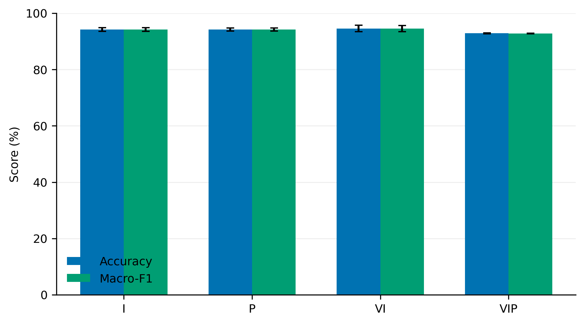
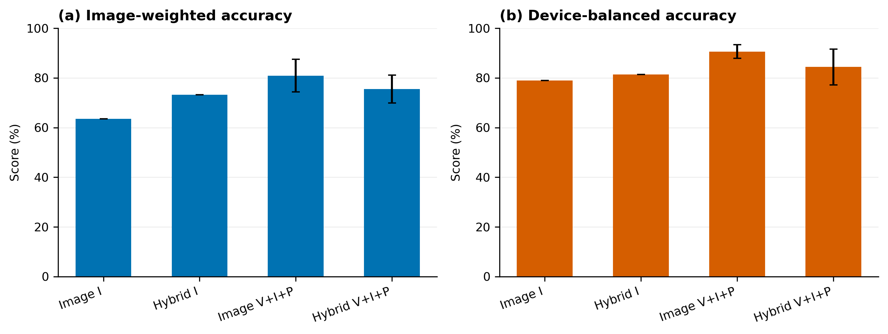
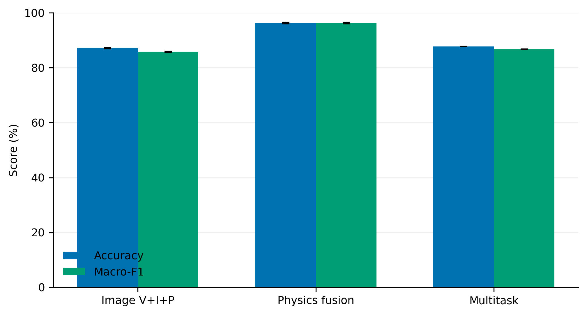
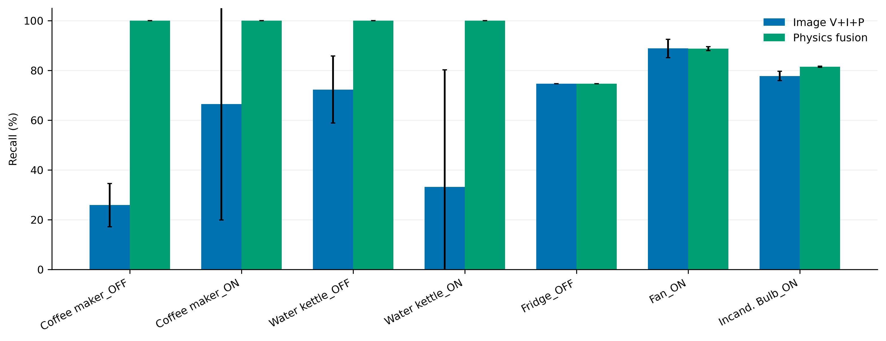

# Leakage-Aware Multi-Physical GASF Imaging for Plug-Load Appliance and State Recognition

**Draft status:** Version 0.3, Electronics submission candidate. ORCID identifiers and the final public-archive DOI remain to be supplied before submission.

**Target journal:** *Electronics* (MDPI), research article.

**Authors:** Xianli Zeng^1,\*, Qinghua Zhou^1

**Affiliation:** ^1 Changsha University of Science and Technology, Changsha 410114, China

**Corresponding author:** Xianli Zeng, zengxianli0626@163.com

**ORCID:** To be completed by the authors in the submission system.

## Abstract

High-frequency voltage and current measurements contain informative load signatures, but image-based recognition can report misleading accuracy when class labels leak into pixels or correlated cycles cross evaluation splits. This study develops a leakage-aware multi-physical Gramian angular summation field (GASF) pipeline for event-aligned plug-load recognition. Voltage-aligned voltage, current, and instantaneous-power cycles are encoded as three-channel images and classified by a compact convolutional neural network (CNN). Two independent PLAID tasks are studied: 11-class appliance-type recognition and 26-label joint appliance-type/ON-OFF recognition. Images contain no rendered labels, primary splits are separated by source recording, and the appliance task is also evaluated with device-disjoint splits. For 11-class recognition, the current-only image model reaches 94.23 +/- 0.66% unseen-recording accuracy, whereas the three-channel model provides the strongest unseen-device transfer at 80.90 +/- 6.61% image accuracy and 90.62 +/- 2.76% mean device accuracy over three device splits. For 26-label recognition, adding 14 physical amplitude, power, power-factor, and harmonic descriptors increases mean test accuracy from 87.06 +/- 0.13% to 96.23 +/- 0.23% and macro-F1 from 85.72 +/- 0.17% to 96.23 +/- 0.24% over three training seeds. The physical branch removes severe Coffee maker/Water kettle confusion under the fixed held-out split. These results provide a compact reference for leakage-controlled electronic load recognition and show that normalized image shape and absolute electrical amplitude encode complementary information.

**Keywords:** non-intrusive load monitoring; appliance recognition; Gramian angular summation field; physical feature fusion; compact CNN; PLAID

## 1. Introduction

Appliance-level electrical information supports energy management, demand response, occupancy-aware services, and fault detection. Installing a sensor on every appliance is expensive, so non-intrusive load monitoring (NILM) infers load activity from a limited number of measurement points [@schirmer_non-intrusive_2023]. High-frequency voltage and current measurements expose switching transients, harmonic structure, and nonlinear voltage-current trajectories that are unavailable in low-rate active-power data [@papageorgiou_nilm_2025]. These signatures can help distinguish both appliance categories and operating states [@yin_non-intrusive_2023; @zhu_new_2025].

Deep learning has made high-frequency plug-load recognition increasingly practical. Reported accuracy, however, can be inflated by two common forms of evaluation leakage. First, generated images may contain class names, axes, filenames, or other metadata rendered into the pixels; a network can then learn text rather than electrical behavior. Second, many adjacent cycles from the same recording are highly correlated, so random image-level splitting can place near-duplicates in both training and test sets. Neither shortcut is available for a genuinely unseen recording or physical appliance.

This study develops and audits a leakage-aware pipeline for two complementary recognition tasks. The first classifies 11 appliance types using individual PLAID recordings. The second combines 13 appliance types with ON and OFF states to form 26 labels and uses a zero-load reference to isolate event-related differential current and power. Each physical sequence is converted to a GASF image, and voltage, current, and power fields are stacked into a three-channel tensor. A compact four-stage CNN provides a low-parameter image baseline. Because per-cycle GASF normalization discards absolute amplitude, the 26-label model is additionally supplied with 14 physical descriptors covering root-mean-square (RMS) amplitude, active and apparent power, power factor, crest factor, total harmonic distortion (THD), and low-order harmonics.

The contributions are:

1. A corrected multi-physical GASF representation whose model input contains only numerical pixels.
2. Recording-grouped evaluation for both tasks and device-disjoint validation for the 11-class task.
3. A controlled channel analysis showing that the best 11-class representation depends on whether evaluation targets unseen recordings or unseen physical devices.
4. A compact image-plus-physics model that improves 26-label recognition and removes a severe heating-load confusion under the fixed held-out split.

The scope is event-aligned plug-load recognition. The study does not claim disaggregation of arbitrary aggregate building mains, state-of-the-art accuracy, or deployment-ready latency.

## 2. Related Work

### 2.1 High-frequency event-based NILM

NILM methods are commonly divided into event-based and non-event-based approaches [@schirmer_non-intrusive_2023]. Event-based methods detect switching transitions and classify the associated load signature, whereas non-event-based methods estimate consumption from aggregate power. Recent reviews emphasize that high-frequency voltage and current data provide richer transient and harmonic evidence but also increase acquisition and processing requirements [@papageorgiou_nilm_2025]. Voltage-current trajectories have been combined with transfer learning [@liu_non-intrusive_2019], deep CNNs [@yin_non-intrusive_2023], and transient-steady-state fusion [@zhu_new_2025]. The present work follows the event-aligned high-frequency setting and evaluates individual plug-load events rather than whole-building disaggregation.

PLAID is a public dataset of high-resolution voltage and current measurements for appliance identification [@gao_plaid_2014]. An early feasibility study demonstrated that high-frequency plug-load signatures can support automated recognition [@gao_plug_load_2015]. Subsequent studies have explored recurrence graphs and image-like time-series encodings [@faustine_improved_2020; @faustine_adaptive_2021], multi-label learning [@faustine_multi-label_2020], and deep feature extraction [@nolasco_deepdfml-nilm_2022]. These studies motivate compact recognition pipelines but also require careful separation of correlated cycles and physical devices.

### 2.2 Time-series imaging

Gramian angular fields map a one-dimensional sequence into a two-dimensional representation through pairwise angular relations [@wang_gaf_2015]. GASF uses `sin(phi_i + phi_j)`, whereas the difference version, GADF, uses `sin(phi_i - phi_j)`. The present implementation explicitly uses GASF. Time-series imaging has previously been explored for load disaggregation [@bousbiat_exploring_2020], multi-label NILM representations [@nalmpantis_time_2020], and adaptive recurrence plots [@shi_non-intrusive_2022]. These representations exploit local shape and periodic structure, but most require min-max or related normalization. Such normalization preserves shape while removing absolute magnitude, which may be unfavorable when two appliances have similar normalized cycles but different power levels.

### 2.3 Physical descriptors and compact models

Hand-crafted electrical descriptors remain useful alongside learned representations. RMS values, active and apparent power, power factor, crest factor, and harmonic ratios are interpretable, inexpensive to compute, and directly related to load physics. Studies of appliance ON/OFF classification and low-complexity disaggregation show the value of such compact information [@pirnat_energy_2024; @devie_low_2024]. Deep models can capture additional nonlinear structure, but their computational cost must be considered for resource-aware applications [@li_survey_2022; @athanasoulias_opt-nilm_2024]. Attention-based and ensemble models provide stronger alternatives at higher complexity [@irani_azad_nonintrusive_2024; @moreno_ensemble_2024].

### 2.4 Evaluation leakage and reproducibility

Grouped validation is required when samples are correlated within recordings or devices. Reproducibility studies have highlighted inconsistent preprocessing, data splits, and reporting practices in NILM [@yan_reproducible_2026; @saleem_comprehensive_2025]. Explainability studies also note that apparently accurate classifiers can rely on information that is not causally related to load operation [@batic_toward_2024]. The present study treats label leakage and source correlation as first-class experimental controls rather than post hoc caveats.

## 3. Data and Problem Definition

### 3.1 PLAID

The experiments use PLAID, a high-frequency plug-load dataset containing voltage and current measurements of household appliances [@gao_plaid_2014]. The sampling frequency is 30 kHz. The 11-class task contains Air Conditioner, Compact Fluorescent Lamp, Fan, Fridge, Hairdryer, Heater, Incandescent Light Bulb, Laptop, Microwave, Vacuum, and Washing Machine. The 26-label task contains ON and OFF variants of Air Conditioner, Blender, Coffee maker, Compact Fluorescent Lamp, Fan, Fridge, Fridge defroster, Hair Iron, Incandescent Light Bulb, Iron solder, Laptop, Vacuum, and Water kettle.

### 3.2 Task definitions and dataset composition

The 11-class target is the appliance category of an individual recording. The 26-label target is the joint appliance-category and operating-state label. A zero-load recording supplies a phase-aligned reference for the second task. Table 1 summarizes the dataset and split sizes.

**Table 1.** PLAID task composition. Counts are numbers of 64 x 64 GASF images. The same recording-grouped split is used for all training seeds within a task.

| Task | Labels | Images | Train | Validation | Test |
|---|---:|---:|---:|---:|---:|
| 11-class appliance type | 11 | 55,000 | 43,592 | 5,686 | 5,722 |
| 26-label type/state | 26 | 130,000 | 102,312 | 13,883 | 13,805 |

### 3.3 Recording-grouped and device-disjoint splits

All cycles derived from the same source recording are assigned to one split. This prevents correlated adjacent cycles from appearing in both training and test data. The 11-class dataset contains 1,772 source groups, and the 26-label dataset contains 2,710 selected source groups. No source group occurs in more than one split.

For the 11-class task, PLAID metadata are used to derive 1,095 device identifiers. A separate leave-device-out protocol ensures that no device appears in both training and test data. Three device split seeds (42, 43, and 44) produce 124, 138, and 121 test devices, respectively. Device-disjoint results answer a different question from recording-grouped results and are therefore reported separately.

## 4. Method

### 4.1 Event-aligned cycle extraction

For the 11-class task, the first CSV column is current and the second is voltage. Upward voltage zero crossings define the start of each cycle. A complete cycle contains 500 samples, corresponding to one 60 Hz period at 30 kHz:

`N = f_s / f_0 = 30,000 / 60 = 500`.

Instantaneous power is:

`p[n] = v[n] i[n]`.

For the 26-label task, a zero-load recording provides a phase-aligned baseline. The model inputs are:

`Delta i[n] = i_load[n] - i_zero[n]`,

`Delta p[n] = p_load[n] - p_zero[n]`,

with the zero-load voltage used as the phase reference. The difference emphasizes the load event and suppresses background components.

### 4.2 GASF image construction

Each physical sequence is independently mapped to `[-1, 1]`:

`x_norm = 2 (x - min(x)) / (max(x) - min(x)) - 1`.

Constant sequences are mapped to zero. The angular representation and GASF matrix are:

`phi = arccos(x_norm)`,

`G_ij = sin(phi_i + phi_j)`.

Each matrix is normalized to `[0, 1]`, quantized to 8 bits, and stacked:

`R = GASF(v)`, `G = GASF(i)`, `B = GASF(p)`.

For the 26-label task, current and power denote the baseline-corrected values. The `500 x 500 x 3` tensor is resized to `64 x 64` using bilinear interpolation. Images are saved directly as numerical RGB arrays. No title, axes, class name, colorbar, filename-derived text, or extra whitespace is rendered into the training image. Figure 1 shows the complete pipeline.

### 4.3 Compact CNN

The image model has four convolutional stages with 16, 32, 64, and 128 channels. Each stage uses a `3 x 3` convolution, batch normalization, ReLU, max pooling, and dropout. Global average pooling is followed by a two-layer classifier. The model has 106,891 parameters for the 11-class task and 107,866 parameters for the 26-label task. Unused input channels are replaced by zero-valued channels so that channel ablations retain the same architecture and parameter count.

Training uses AdamW with learning rate `5 x 10^-4`, weight decay `10^-4`, batch size 64, label smoothing 0.05, and validation-based early stopping with patience 10. The learning rate is reduced by a factor of 0.7 after three epochs without validation-accuracy improvement. The checkpoint with the highest validation accuracy is evaluated once on the test set. Seeds 42, 43, and 44 control weight initialization and minibatch order while retaining the same data split.

### 4.4 Physical-feature fusion

Per-cycle GASF normalization retains waveform shape but removes absolute amplitude. The 26-label model therefore uses 14 additional physical features:

- RMS voltage and current;
- active and apparent power;
- power factor;
- current peak and crest factor;
- current THD from harmonics 2 through 9;
- third-, fifth-, and seventh-harmonic ratios;
- mean absolute current and power;
- logarithm of absolute active power.

The image encoder outputs 128 features and the physical branch maps the 14 standardized descriptors to a 32-dimensional embedding. The concatenated 160-dimensional vector is classified by a compact multilayer network with 96 hidden units. The fusion model contains 117,498 parameters, approximately 9,600 more than the image-only model. Feature standardization is fitted using training data only.

### 4.5 Leakage controls

The reported experiments use the following controls:

1. Images contain only numerical pixels and fixed-size interpolation.
2. Primary splits are separated by source recording.
3. The 11-class device study separates physical devices across training, validation, and test sets.
4. Image-level random splitting is not used for reported performance.
5. The test set is not used for hyperparameter or checkpoint selection.
6. Physical-feature normalization statistics are computed only from training data.
7. Source identifiers and labels are never model inputs.

### 4.6 Metrics and uncertainty

Accuracy and macro-F1 are computed on the held-out test split. For device-level analysis, we report image-weighted accuracy, mean per-device accuracy, and a class-balanced device mean that first averages within each device and then gives appliance classes equal weight. Means and standard deviations summarize three training seeds under one fixed data split unless otherwise stated. They quantify optimization variability, not independent resampling uncertainty of the test set.

## 5. Results

### 5.1 Leakage audit

Historical image files from the development pipeline contained rendered class and state text. Resizing the full image to `64 x 64` retained a class-specific top band. In a reduced-scale diagnostic, a top-row-only input reached 99.83% accuracy for 26 labels when the title-bearing image was used. A second diagnostic retained only the top 12 rows after resizing and compared title-bearing with title-free images (Figure 2); the title-free condition reduced test accuracy from 87.83% to 76.42%. These diagnostics establish that class-dependent text was directly learnable and that the historical near-perfect results cannot be interpreted as waveform-recognition performance.

After correction, generated images contain only numerical GASF pixels. The corrected recording-grouped split has zero source-group overlap. The 11-class device-disjoint splits have zero device overlap across train, validation, and test sets.

### 5.2 Eleven-class recording-level performance

Table 2 reports the channel comparison under the recording-grouped split.

**Table 2.** Eleven-class unseen-recording performance by input channel. Values are mean +/- standard deviation over training seeds 42, 43, and 44.

| GASF input | Test accuracy | Test macro-F1 | Parameters |
|---|---:|---:|---:|
| Current only (I) | 94.23 +/- 0.66% | 94.20 +/- 0.67% | 106,891 |
| Power only (P) | 94.20 +/- 0.53% | 94.17 +/- 0.54% | 106,891 |
| Current + voltage (V+I) | **94.57 +/- 1.14%** | **94.54 +/- 1.14%** | 106,891 |
| Three-channel (V+I+P) | 92.86 +/- 0.13% | 92.82 +/- 0.09% | 106,891 |

V+I has the highest mean test score, but its seed variability is approximately nine times that of V+I+P for accuracy. I is the simplest input and performs within 1.34 accuracy points of V+I. The apparent recording-level gain from adding channels is therefore small and seed-dependent. Figure 3 visualizes this comparison.

### 5.3 Eleven-class device-level performance

Table 3 reports the leave-device-out results. The selected model for unseen-device transfer is the three-channel image CNN.

**Table 3.** Eleven-class leave-device-out performance. Image V+I+P and Hybrid V+I+P are evaluated over three device split seeds; the I configurations use seed 42 only and are not directly comparable in variance.

| Model | Splits | Image accuracy | Image macro-F1 | Device mean | Class-balanced device |
|---|---:|---:|---:|---:|---:|
| Image I | 1 | 63.51% | 65.08% | 78.94% | 77.69% |
| Image V+I+P | 3 | **80.90 +/- 6.61%** | **81.78 +/- 6.81%** | **90.62 +/- 2.76%** | **88.20 +/- 2.46%** |
| Hybrid I | 1 | 73.20% | 74.89% | 81.37% | 82.19% |
| Hybrid V+I+P | 3 | 75.54 +/- 5.61% | 77.12 +/- 5.18% | 84.42 +/- 7.22% | 81.51 +/- 9.30% |

The image-only three-channel model provides the strongest device-level result. Adding physical features improves selected categories such as Fridge and Fan but reduces overall device-balanced performance and stability. Since the I configurations use one device split, the large descriptive gap should be interpreted as evidence for selecting V+I+P for further device evaluation, not as a fully replicated comparison. Figure 4 shows image-weighted and device-balanced scores.

### 5.4 Twenty-six-label results

Table 4 compares the 26-label models.

**Table 4.** Twenty-six-label test performance under the recording-grouped split. Image and fusion rows summarize seeds 42, 43, and 44; the multitask comparison is one run with seed 42.

| Model | Test accuracy | Test macro-F1 | Parameters |
|---|---:|---:|---:|
| Image V+I+P, three seeds | 87.06 +/- 0.13% | 85.72 +/- 0.17% | 107,866 |
| Multitask type/state, seed 42 | 87.74% | 86.84% | 111,215 |
| Image + physical features, three seeds | **96.23 +/- 0.23%** | **96.23 +/- 0.24%** | 117,498 |

Physical fusion improves image-only mean performance by 9.18 accuracy points and 10.51 macro-F1 points. The single-seed multitask model improves by only 0.68 and 1.12 points relative to the image-only mean. Because the multitask comparison uses one seed, that difference is descriptive rather than a definitive architecture ranking. Figure 5 summarizes the comparison.

### 5.5 Class-specific effects

Table 5 reports selected recalls for the 26-label image and fusion models.

**Table 5.** Selected 26-label recalls for the image-only and physical-fusion models. Fusion values are means over three training seeds.

| Class | Image V+I+P | Physical fusion |
|---|---:|---:|
| Coffee maker_OFF | 25.89% | **100.00%** |
| Coffee maker_ON | 66.54% | **100.00%** |
| Water kettle_OFF | 72.32% | **100.00%** |
| Water kettle_ON | 33.22% | **100.00%** |
| Fridge_OFF | 74.63% | 74.63% |
| Fan_ON | 88.85% | 88.79% |
| Incandescent Light Bulb_ON | 77.78% | 81.52% |
| Compact Fluorescent Lamp_OFF | 99.02% | 94.34% |

The image-only model changes the Coffee maker/Water kettle assignment across seeds. Fusion produces 100% recall for all four classes in every seed. This demonstrates seed-stable separation on the fixed test split; it does not establish perfect performance on new households or devices. Figure 6 shows these differences.

Fridge_OFF remains exactly 74.63% across seeds. Its errors move to Compact Fluorescent Lamp_ON, Fridge defroster_OFF, Laptop_ON, and Blender_ON in different seeds, suggesting a persistent data or operating-condition challenge that cannot be attributed definitively from the present experiment. Incandescent Light Bulb_ON also remains below 82%, while CFL_OFF declines from 99.02% to 94.34% after fusion. The physical descriptors therefore provide a large aggregate gain but are not uniformly beneficial for every class.

### 5.6 Training stability

The physical-fusion model reaches best validation accuracies of 98.04%, 98.11%, and 98.02% for seeds 42, 43, and 44. Test accuracies are 96.28%, 95.99%, and 96.43%, respectively. The validation-to-test gap is consistent across seeds, and no single initialization is responsible for the mean fusion result. Because all seeds use the same fixed test split, these values do not represent test-set resampling variability.

## 6. Discussion

The central result is the difference between leakage-free recording-level performance and device-level transfer. Removing rendered labels and separating correlated recordings prevents the network from exploiting shortcuts unavailable in deployment. A high image-level accuracy can therefore be interpreted as recognition of waveform signatures rather than recognition of embedded text. The device-disjoint experiment shows that recording-level accuracy alone is not sufficient evidence of transfer to new physical equipment.

The 11-class channel study does not support the assumption that more physical channels always improve classification. Current-only GASF is nearly as accurate as the best recording-level model and uses a single physical sequence. The three-channel model is substantially stronger when entire devices are held out, where voltage and power may provide complementary robustness to device-specific current amplitude and waveform variation. The device result is nevertheless based on three partitions of one dataset, and the I baseline uses one partition; broader device-level replication is required before making a universal robustness claim.

For the 26-label problem, GASF shape alone is insufficient. Coffee maker and Water kettle are both heating loads with similar normalized temporal patterns. Per-cycle normalization removes the absolute power magnitude that helps separate them. Adding RMS current, active power, power factor, and harmonic descriptors restores this information and removes the severe label instability across seeds. The unchanged Fridge_OFF recall indicates that the gain is class-dependent: the added descriptors solve one dominant confusion but do not compensate for every ambiguous operating condition.

The multitask experiment shows that output-head factorization alone does not solve the problem. The state head reaches 98.87% accuracy, whereas the appliance-type head remains near 87.77%. Joint recognition is therefore limited primarily by load-type separation rather than by state decomposition. A future multitask model that also fuses physical descriptors may combine the benefits of explicit task structure and amplitude information.

From an electronics perspective, the model remains small. The image model contains approximately 0.11 million parameters, and physical fusion adds approximately 9,600 parameters. The `64 x 64` representation limits storage and arithmetic requirements relative to larger image backbones. However, parameter count is not a deployment measurement. Device latency, peak memory, and energy consumption have not been measured, so the work does not claim real-time or edge-ready operation.

The leakage audit has broader methodological implications. Image conversion is often presented as a preprocessing detail, but axes, titles, colorbars, and filenames create a separate information channel. Source-grouped splitting is also necessary when each recording yields many highly similar cycles. Reporting both recording- and device-disjoint results separates two distinct generalization questions and makes failure modes visible.

## 7. Limitations

1. Only PLAID is evaluated; cross-dataset and cross-household generalization remain unknown.
2. The task uses event-aligned plug-load recordings rather than arbitrary aggregate mains.
3. The zero-load baseline may not be available or perfectly phase-aligned in every deployment.
4. The 11-class device map is derived from metadata; conservative per-sample identifiers are used when brand or model information is missing.
5. The I device baselines use one device split, whereas V+I+P uses three; a fully replicated comparison remains desirable.
6. The 26-label multitask comparison uses one training seed.
7. Fridge_OFF and Incandescent Light Bulb_ON remain weak, and CFL_OFF recall decreases after fusion.
8. The final image resolution is `64 x 64`; larger resolutions and larger backbone models require separate experiments.
9. No measured inference latency, memory footprint, or energy consumption is reported.
10. The result is established on one fixed recording-grouped split; the three-seed standard deviation describes optimization variability rather than split uncertainty.

## 8. Conclusion

This study presents a leakage-aware multi-physical GASF pipeline for plug-load appliance and state recognition. Corrected images contain only numerical pixels, and primary splits are separated by source recording. The 11-class task reaches 94.23% recording-level accuracy with the compact current-only GASF model, while the three-channel image model provides the strongest device-level transfer at 80.90% image accuracy and 90.62% mean device accuracy across three device splits.

For 26-label recognition, physical-feature fusion increases mean test accuracy and macro-F1 to 96.23% over three training seeds and eliminates the unstable Coffee maker/Water kettle assignment on the fixed held-out split. Fridge and selected lighting states remain difficult. The results provide a reproducible, compact, and physics-informed baseline while showing that leakage-aware grouped and device-disjoint evaluation is essential for credible NILM performance claims.

## Author Contributions

Conceptualization, X.Z.; methodology, X.Z.; software, X.Z.; validation, X.Z.; formal analysis, X.Z.; investigation, X.Z.; data curation, X.Z.; writing-original draft preparation, X.Z.; supervision, Q.Z.; project administration, Q.Z.; writing-review and editing, Q.Z. Both authors have read and agreed to the published version of the manuscript.

## Funding

This research received no external funding.

## Institutional Review Board Statement

Not applicable.

## Informed Consent Statement

Not applicable.

## Data Availability Statement

PLAID is available from its original providers under the conditions described in its dataset record. The corrected implementation, split-generation scripts, derived metadata, manuscript sources, and figure-generation scripts are maintained in the project repository at https://github.com/zxl664089808/nilm-gasf-fusion. Repository tag `paper-v0.3` identifies the exact snapshot accompanying this manuscript. A versioned public archive with a persistent DOI will be linked before publication. Raw PLAID recordings, large image caches, and trained weights are not redistributed.

## Conflicts of Interest

The authors declare no conflicts of interest.

## Abbreviations

CNN, convolutional neural network; GASF, Gramian angular summation field; GADF, Gramian angular difference field; NILM, non-intrusive load monitoring; PLAID, Plug Load Appliance Identification Dataset; RMS, root mean square; THD, total harmonic distortion.

## References

[[INSERT RENDERED REFERENCE LIST FROM references_cited.bib]]

## Pre-Submission Checklist

- Add both ORCID identifiers and verify the CRediT allocation.
- Deposit the repository snapshot in Zenodo (or another DOI service) and replace the commit-only statement with the public archive DOI.
- Confirm whether the GitHub repository is public; otherwise make it public at acceptance.
- Convert the manuscript, tables, and vector figures to the current Electronics template.
- Recheck all numerical values against the frozen result tables and final repository commit.
